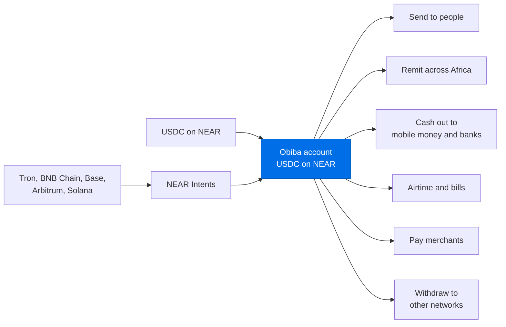
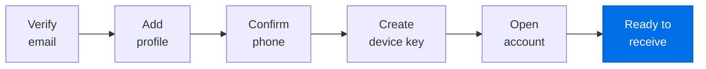
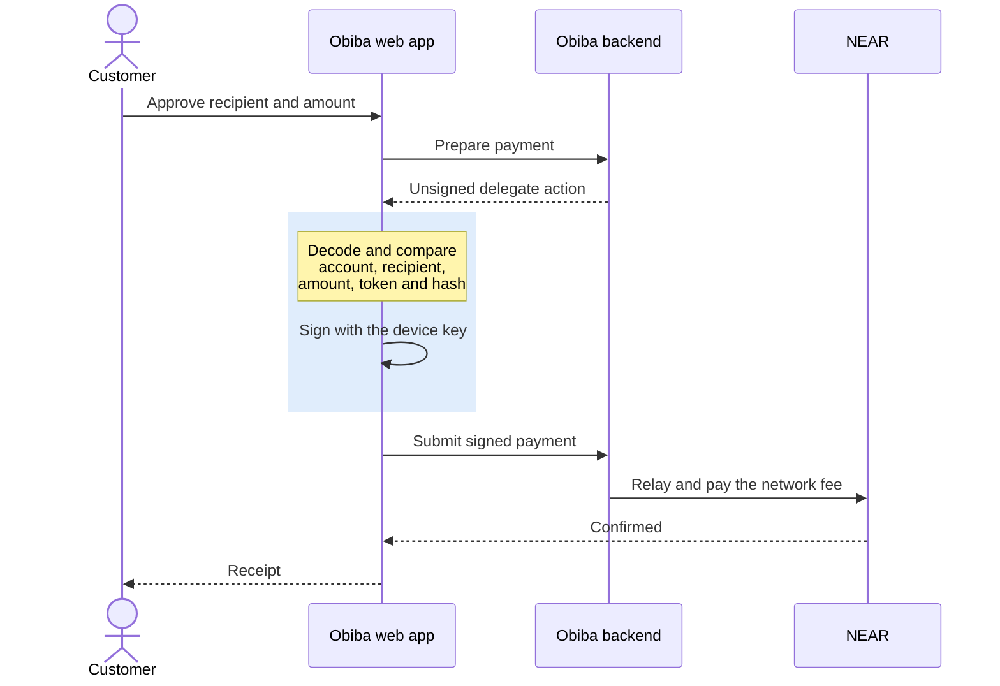
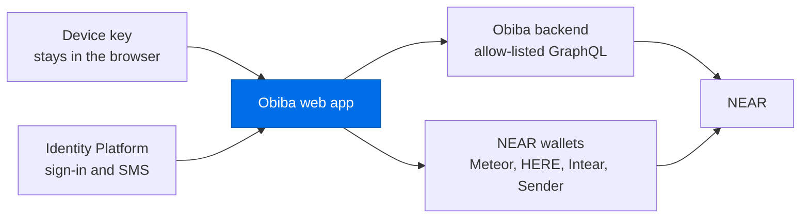

<picture>
  <source media="(prefers-color-scheme: dark)" srcset="https://app.obibajk.com/brand/obiba-logo-light.png">
  
</picture>

### Digital dollars for Africa, in an account you control.

Obiba gives people in Ghana and across Africa a USDC account that works like a banking app. Sign up with an email and phone number, receive money from NEAR and five other networks, then send, cash out and pay bills. There is no seed phrase to write down and no gas token to buy, and only the customer's device can approve a payment.

**[Open Obiba](https://app.obibajk.com)**



## What customers can do

| | |
| --- | --- |
| **Add money** | Receive USDC on NEAR, deposit from Tron, BNB Chain, Base, Arbitrum or Solana, or connect a NEAR wallet |
| **Send** | To any Obiba customer by name or phone number, or to any NEAR account, with network fees covered |
| **Remit** | To mobile money and banks in Ghana, Kenya and Nigeria, and to banks in South Africa |
| **Cash out** | To MTN, Telecel and AT mobile money, or to GCB, Ecobank, Stanbic, Absa and Fidelity |
| **Pay bills** | Airtime and data, ECG prepaid electricity, Ghana Water, DStv and GOtv |
| **Get paid** | Request money with a QR code or payment link backed by a signed invoice |
| **Withdraw** | To NEAR accounts, or to USDC on Base and Arbitrum |
| **Track** | Balance in USDC or cedis, full activity, receipts and notifications |

## Why Obiba is different

| | |
| --- | --- |
| **Familiar from the first screen** | Email, phone and a device. No seed phrase, no gas token and no blockchain vocabulary |
| **The customer holds the key** | Each payment is signed by a key created in the customer's browser, which cannot be exported, even by Obiba |
| **What you approve is what you sign** | The app decodes every payment itself and refuses to sign if a single field differs from what the customer approved |
| **Lost devices are recoverable** | SMS and email verification, followed by a 48-hour on-chain delay that an existing device can cancel |

## Five steps to a working account



## How a payment is approved

The server prepares each payment, but it is never trusted. The browser checks the exact bytes it is about to sign.



## Inside the app



| Layer | Protection |
| --- | --- |
| Device key | Non-extractable Ed25519 key. The app tests the browser first and declines to create a key it could not protect |
| Payment signing | Recipient, amount, token, method, invoice and signing hash are checked before every signature |
| API access | Only operations compiled into the app, identified by SHA-256 hash, reach the backend |
| Page integrity | A per-page Content Security Policy pins every inline script by hash |
| Sign-in | Identity Platform with an SMS second factor |

## Availability

The hosted app runs on NEAR testnet. Cross-chain routes use NEAR Intents through 1Click, which operates on NEAR mainnet. Mobile money, bank, remittance and bill payments run on a pilot rail pending provider integrations.

<details>
<summary>Technology</summary>

| Area | Choice |
| --- | --- |
| Framework | Next.js 16 static export, React 19, TypeScript |
| Styling | Tailwind CSS 4, Inter |
| Identity | Firebase SDK on Identity Platform |
| NEAR | near-api-js, NEAR Wallet Selector |
| Cryptography | WebCrypto Ed25519, IndexedDB key storage |
| API | GraphQL with persisted operations |

</details>

<details>
<summary>Run locally</summary>

Requires Node 22 and pnpm 10.

```bash
pnpm install
cp .env.example .env.local
pnpm dev
```

`pnpm build` writes the static site to `out/`.

</details>

<details>
<summary>Static hosting notes</summary>

- Pages export as directories, so direct links and refreshes work on any static host.
- Record pages take their ID as a query parameter, for example `/activity/detail?id=...`. Build links with `src/lib/routes.ts`.
- Payment links issued as `/pay/<id>` are forwarded by `src/app/not-found.tsx` from the `404.html` page.
- `scripts/finalize-static.mjs` writes each page's Content Security Policy after the build.

</details>
